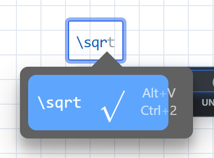
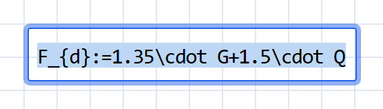
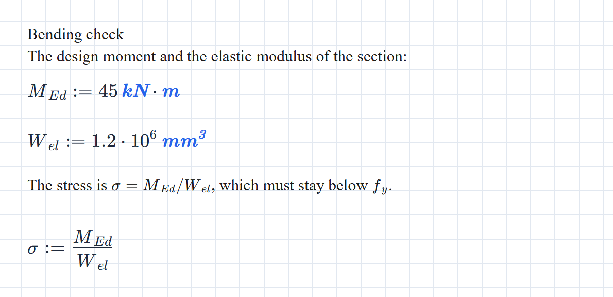

:::note[What is LaTeX?]
A plain-text language for typesetting maths, and the standard in scientific publishing. Commands start with a backslash: `\frac{a}{b}` gives $\frac{a}{b}$, `\sqrt{x}` gives $\sqrt{x}$, `\alpha` gives $\alpha$.
:::

Every maths block is LaTeX underneath. The editor turns what you type into LaTeX as you go, and the engine reads that LaTeX to compute. Most people never see it. If you already think in LaTeX, you can work with it directly: type commands, edit a block's source, paste equations in and copy them out.

One thing to hold on to: the editor can *display* far more LaTeX than the engine can *compute*. The second half of this page is where the two part company.

Everything here works on every plan.

## Type a command

Press <kbd>&#92;</kbd> in a maths block and the field switches to LaTeX entry: what you type shows as source, with matching commands listed below it.



Press <kbd>Space</kbd> or <kbd>Esc</kbd> to finish. The command is typeset in place, ready for its contents: `\sigma`, <kbd>Space</kbd>, then `_d` gives $\sigma_d$. A whole construct works too: type `\frac{1}{2}` and press <kbd>Esc</kbd> for $\frac{1}{2}$.

Don't finish with <kbd>Enter</kbd>. It accepts the highlighted suggestion when the list is showing, but at other times it also finishes the block and opens a new one below, as <kbd>Enter</kbd> does everywhere in a maths block.

For everyday symbols you rarely need the backslash, because the editor converts familiar spellings as you type:

| Type | You get |
| :-- | :-- |
| `alpha`, `theta`, `Delta`, … | $\alpha$, $\theta$, $\Delta$, … |
| `pi` | $\pi$ |
| `x/2` | $\frac{x}{2}$ |
| `*` | $\cdot$ |
| `<=`, `>=`, `!=` | $\le$, $\ge$, $\ne$ |
| `->` | $\to$ |

Function names stay as typed: `sqrt` is the function `sqrt`, not a root sign. A few of the editor's own shortcuts are switched off, such as `th`, `lim` and `int`, which would otherwise turn the middle of `pythagoras`, `limit` or `interp` into an operator. MathLive's [keyboard shortcuts](https://mathlive.io/mathfield/reference/keybindings/) page lists the rest.

## Edit a block's source

Select part or all of a block and press <kbd>Esc</kbd>. The selection opens as LaTeX source, ready to edit:



<kbd>Shift</kbd> + <kbd>Home</kbd> from the end of a block selects all of it. <kbd>Ctrl</kbd> + <kbd>A</kbd> won't: it selects every block on the sheet, even from inside a maths block.

Press <kbd>Esc</kbd> to put the edited source back. The result stays selected and the field is still taking LaTeX, so press <kbd>Esc</kbd> once more, or an arrow key, before you type on. Clicking away keeps the edit too.

It's the quickest fix for anything the editor makes awkward: a subscript that swallowed the operator after it, a bracket grouped the wrong way, a unit spelling (see [Units](#units)).

## Paste LaTeX into a block

With the caret in a maths block, paste LaTeX and it arrives as maths. Delimiters are stripped first, so `$…$`, `$$…$$`, `\(…\)` and `\[…\]` all paste cleanly.

The LaTeX comes in exactly as written. Nothing translates it into the spellings the engine understands, so a `\dfrac` from a paper stays a `\dfrac` and fails (see [What doesn't compute](#what-doesnt-compute)).

## Paste a document onto the page

Paste onto an empty spot of the page instead, with nothing being edited, and the text is split into blocks for you, in reading order:

- `$$…$$` or `\[…\]` makes a maths block, wherever it sits, even mid-sentence or across lines.
- A line that is entirely `$…$` or `\(…\)` makes a maths block.
- A line of bare LaTeX makes a maths block: it needs a maths command or a braced subscript such as `a_{1}`, no unknown commands (so a Windows path stays prose) and no two words in a row.
- Everything else is prose. Consecutive lines, paragraphs included, share one text block, and `$…$` inside a sentence stays there for the text block to typeset.

So this:

```text
Bending check

The design moment and the elastic modulus of the section:
$$M_{Ed}:=45\operatorname{kN}\cdot\operatorname{m}$$
\[W_{el}:=1.2\cdot10^{6}\operatorname{mm}^3\]
The stress is $\sigma = M_{Ed}/W_{el}$, which must stay below $f_y$.
\sigma:=\frac{M_{Ed}}{W_{el}}
```

pastes as five blocks:



The whole paste is one undo step. A derivation from a paper, or an answer from a chatbot, becomes a paste and a tidy-up. Check what came in, though: a pasted `=` defines, exactly like a typed one, so an equation the source meant as a statement becomes a definition of whatever is on its left.

## Copy LaTeX out

With the caret in a maths block, <kbd>Ctrl</kbd> + <kbd>C</kbd> copies LaTeX: the selection if you've made one, the whole block if not. It comes wrapped in display delimiters, ready for a LaTeX document, Markdown, or a paste back onto a page:

```text
$$ F_{d}:=1.35\cdot G+1.5\cdot Q $$
```

Copying a selected block, rather than the maths inside it, is different. That copies the block itself, which pastes into any calcsheet but isn't LaTeX anywhere else.

## How the engine reads LaTeX

The editor can display over 800 LaTeX commands. The engine computes a subset, and a command outside it is almost always an error rather than something skipped.

### What computes

| LaTeX | Means |
| :-- | :-- |
| `:=` or `=` | A definition. A single `=` defines; it never tests. |
| `==`, `\ne`, `<`, `>`, `\le` or `\leq`, `\ge` or `\geq` | A comparison. See [Assertions](/guides/assertions/). |
| `+`, `-`, `\cdot`, `\times`, `\div` | Arithmetic. Between two vectors, `\times` is the dot product, the same as `\cdot`; use `cross(u, v)` for the cross product. |
| `\frac{a}{b}`, `a^{b}`, `\sqrt{x}`, `\sqrt[n]{x}`, `n!`, `50\%` | Fraction, power, roots, factorial, percent. |
| `\left( … \right)` or `( … )` | Grouping. |
| `\left\| x \right\|` | Absolute value; the length of a vector, or the determinant of a square matrix. |
| `\lfloor x \rfloor`, `\lceil x \rceil` | Floor and ceiling. |
| `\sin`, `\cos`, `\tan`, `\cot`, `\sec`, `\csc`, `\arcsin`, `\arccos`, `\arctan`, `\sinh`, `\cosh`, `\tanh` | Trigonometry, in radians unless the angle carries a unit. |
| `\ln`, `\log`, `\log_{b}`, `\exp`, `e^{x}` | Natural log, base-10 log, base-$b$ log, exponential. |
| `\max`, `\min`, `\det` | The functions of those names. |
| `\operatorname{mod}\left(7, 3\right)` | Any built-in or user function, by name. |
| `\pi`, `e` | The constants. |
| `\infty` | Infinity, shown as ∞: $1/\infty$ is $0$. An integral's limits must still be finite. |
| `\text{M12}` | Text, for labels and table keys. |
| `\begin{pmatrix} … \end{pmatrix}`, also `bmatrix`, `Bmatrix`, `matrix` | A matrix. A single column is a vector. |
| `\begin{vmatrix} … \end{vmatrix}` | The determinant of that matrix. |
| `M^{\top}`, `M^{\mathrm{T}}`, `M^{\intercal}` | Transpose. |
| `v\left[2\right]`, `M\left[1,2\right]` | An element, counting from 1. |
| `\land` or `\wedge`, `\lor` or `\vee`, `\lnot` or `\neg` | And, or, not, in conditions. |
| `\to` or `\rightarrow` | The symbolic arrow. See [Symbolic maths](/guides/symbolic-maths/). |
| `\int_{a}^{b} f\,dx` | A definite integral, worked out numerically; nested for a double or triple integral. See [Integrals](/guides/integrals/). |
| `1.5\cdot10^{-3}`, `1.5e-3` | Scientific notation. |

Spacing commands (`\,`, `\;`, `\quad`) are for looks. Between digits they vanish, so `1\,000` is a thousand.

### Names

- **A run of letters is one name.** `ab` is the name *ab*, not $a$ times $b$, and since LaTeX ignores spaces in source, so is `a b`. Write `a \cdot b`. A thin space (`\,` or `\;`) between two letters also reads as a product, but `\quad` doesn't and `\:` isn't understood, so `\cdot` is the safe choice.
- **A subscript is part of the name.** `F_{y}` and `F_y` are the same name. Inside a subscript use plain letters or `\mathrm`, never `\text`: `T_{\mathrm{max}}` works, `T_{\text{max}}` fails with an *Unexpected operator* message.
- **A Greek letter joins the letters after it**, space or no space: `\Delta T` is the one name $\Delta T$. Put `\cdot` after a Greek letter you mean to multiply. `\phi` and `\varphi` are the same name; `\epsilon` and `\varepsilon` are two.
- **An accent is part of the name.** `\hat{x}`, `\bar{x}` (or `\overline{x}`), `\vec{F}` and `\tilde{x}` are names in their own right. Avoid `\dot{x}` and `\ddot{x}`: a definition `\dot{x} := 3` is accepted, but no block can read it back.
- **So is a style.** `\mathbf{F}` is a different name from `F`. Pick one spelling and keep to it.

### Units

- **`\operatorname{kN}`** is what the editor writes when you type a unit after a number (you'll also see it as `\operatorname{\mathrm{kN}}`, which reads the same). It means the unit unless the sheet defines a variable of that name, in which case it means the variable.
- **`\mathrm{kN}`** always means the unit, whatever the sheet defines. It's the spelling the block menu's **Treat … as Unit** writes.
- **Degrees** are `30\degree`, which is what the toolbar's **°** button writes. The usual LaTeX `30^{\circ}` doesn't compute.
- siunitx's `\SI{…}{…}` and `\qty{…}{…}` aren't understood. Write the number, then the unit.

### Conditionals

The inline form is `\operatorname{if}\left(c, a, b\right)`. The multi-line form is a left-aligned array, which is also how calcsheet files store it:

```latex
\begin{array}{l}\text{if }n>9\\\quad 1\\\text{else if }n>4\\\quad 2\\\text{else}\\\quad 3\end{array}
```

`\begin{cases}` doesn't compute; this array is its replacement.

### What doesn't compute

| LaTeX | Write instead |
| :-- | :-- |
| `\dfrac`, `\tfrac`, `\cfrac` | `\frac` |
| `\neq` | `\ne` |
| `\approx`, `\equiv` | `==`, for a check |
| `\pm` | Two blocks, one for each sign |
| `\binom{n}{k}` | `\frac{n!}{k!\left(n-k\right)!}` |
| `a \bmod b` | `\operatorname{mod}\left(a, b\right)` |
| `\sum`, `\prod` | `\operatorname{sum}` or `\operatorname{prod}` of a vector |
| `\frac{d}{dx}` | The `derivative` function |
| `\int f\,dx` without limits | Add the limits: only definite integrals compute |
| `\lim` | Nothing: there are no limits |
| `\begin{cases}` | The multi-line `if` above |
| `aligned`, `align`, `gather` | One equation per block |
| `\color`, `\textcolor`, `\boxed` | Nothing: styling doesn't compute |
| `\newcommand` | Nothing: there are no macros |
| `30^{\circ}` | `30\degree` |
| `\SI{…}{…}`, `\qty{…}{…}` | The number, then the unit |
| `T_{\text{max}}` | `T_{\mathrm{max}}` |
| `\dot{x}`, `\ddot{x}`, `x'` | Another name, such as `v_{x}` |
| `v[2]`, `v\lbrack 2\rbrack` | `v\left[2\right]` |

The messages these produce describe the engine's reading, not your LaTeX: *Bad escape character \d* for a `\dfrac`, *Undefined function Error*, or *Undefined function* followed by an internal name such as *Sum* or *At*. When a pasted block shows one of those, look for a command from this table.

## Edit the file

A `.mez` file is a zip archive. Inside, `worksheet.yaml` holds the sheet, and each maths block's LaTeX is its `value`:

```yaml
  - id: "42d8fa98-b75f-44fe-b90d-9de543200425"
    type: "math"
    layout:
      page: 1
      x: 60
      y: 865
      width: 300
      height: 50
    value: "V_{c}\\left(R,h\\right):=\\pi\\cdot\\left(R^2-\\frac{h^2}{4}\\right)\\cdot h"
```

The value is a double-quoted YAML string, so every backslash is doubled. That makes the file the place for sheet-wide surgery: a search and replace in a text editor fixes forty pasted `\dfrac`s in one go.

To edit one:

1. Work on a copy. Rename it from `.mez` to `.zip` and extract it.
2. Edit `worksheet.yaml`.
3. Zip it back up with `worksheet.yaml` at the top of the archive, beside the `diagrams` and `images` folders, not inside a folder of its own.
4. Rename it to `.mez` and open it from Home with **Open from local drive**.

**Open from local drive** also takes `worksheet.yaml` on its own. The maths and text come through; diagrams and images don't, because they live in the archive beside it.

## LaTeX in text blocks

Text blocks typeset LaTeX between dollar signs, so `$\sigma_d$` in a sentence gives $\sigma_d$. That maths is for reading only; nothing in a text block computes. The rules for when a dollar sign starts maths are in [Text blocks](/guides/text-blocks/#inline-maths).

## Further reading

- [LaTeX Commands](https://mathlive.io/mathfield/reference/commands/) (MathLive): every command the maths editor can display. Display, not compute; check a command against this page before relying on it.
- [Keyboard Shortcuts](https://mathlive.io/mathfield/reference/keybindings/) (MathLive): the editor's keys and typed shortcuts, a few of which Maths Explore switches off.
- [Mathematical expressions](https://www.overleaf.com/learn/latex/Mathematical_expressions) (Overleaf): a short introduction to writing maths in LaTeX.
- [List of Greek letters and math symbols](https://www.overleaf.com/learn/latex/List_of_Greek_letters_and_math_symbols) (Overleaf): find a symbol by sight.
- [Detexify](https://detexify.kirelabs.org/classify.html): draw a symbol, get its command.
- [LaTeX/Mathematics](https://en.wikibooks.org/wiki/LaTeX/Mathematics) (Wikibooks): the thorough reference, environments and all.
- [Pandoc's `tex_math_dollars`](https://pandoc.org/MANUAL.html#extension-tex_math_dollars): the convention text blocks follow for when a dollar sign starts maths.

## See also

- [Text blocks](/guides/text-blocks/) for prose and inline maths.
- [Matrices](/guides/matrices/) for vectors, elements and transpose.
- [Symbolic maths](/guides/symbolic-maths/) for the arrow and `derivative`.
- [Assertions](/guides/assertions/) for comparisons.
- [Keyboard shortcuts](/guides/keyboard-shortcuts/) for every key in a maths block.
