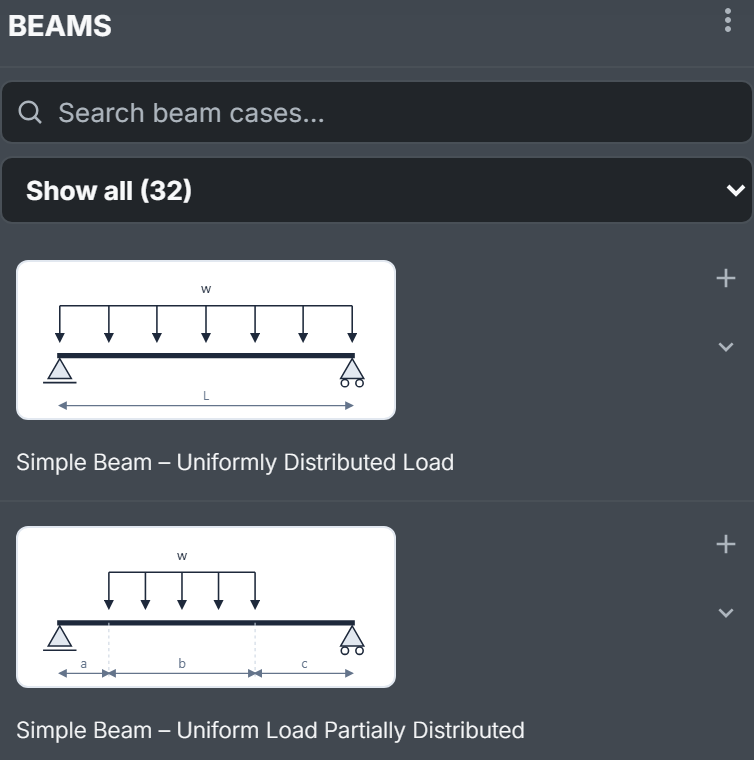
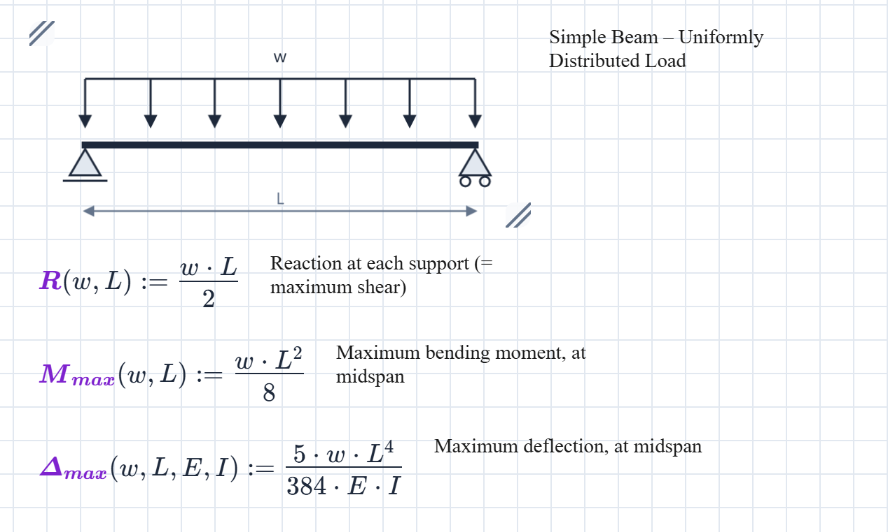
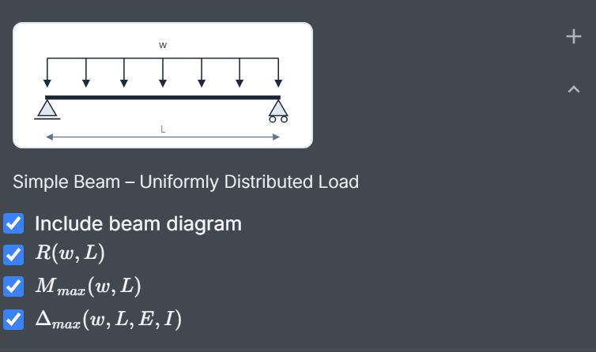
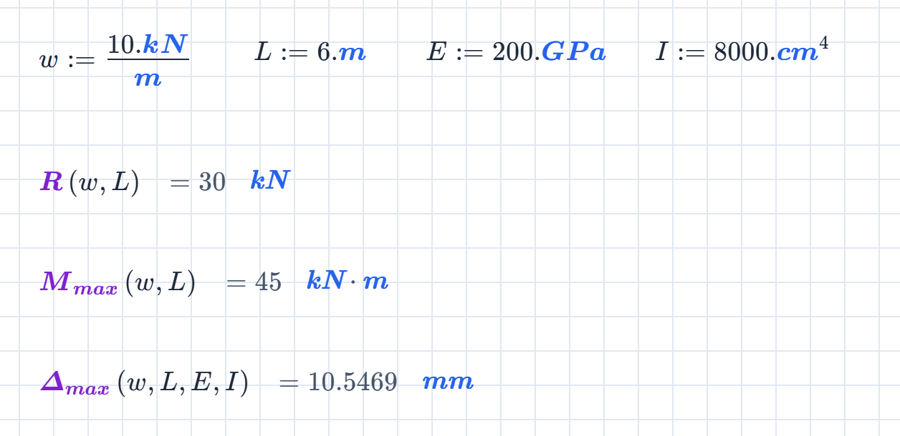
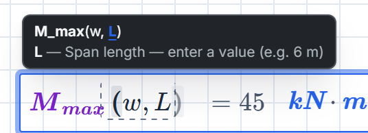

The **Beams** extension is a catalogue of 32 standard beam cases: simple spans, cantilevers, propped cantilevers, overhangs, fixed ends and two-span continuous beams.

Pick one and it lands on the calcsheet as a schematic plus a set of live functions for its reactions, shears, moments and deflections. 

Beams is free on every plan. It needs an account; in the no-account demo the tab shows a sign-up prompt instead. 

## Find a case

Click the beam icon in the activity bar to open the **BEAMS** panel. Each case shows its schematic and its name.

Two filters narrow the list, and they stack:

- **The category menu** (**Show all (32)** to start) picks one kind of beam: Simple Beams, Cantilever Beams, Propped Cantilevers, Overhanging Beams, Fixed-End Beams or Continuous Beams.
- **The search box** matches the letters you type, in order, against each case's name and summary, and puts the best match first. It ranks more than it filters: `udl` keeps 29 of the 32 cases but leads with the fully loaded uniform spans, and `cant point` puts **Cantilever Beam – Concentrated Load at Any Point** on top.

## Insert a case

Click the page where the case should go; the beacon marks the spot. Then press **+** beside the case. With no beacon, it goes below everything already on the sheet.

What lands:

- **The schematic**, as a diagram block, with the case name as its description.
- **One maths block per formula**, each a function definition with a one-line description to its right saying what it gives and where.

The case arrives selected, so you can drag it into place in one go, and a single **Undo** takes all of it off again. A function definition shows no result of its own; it waits to be called.

## Choose what comes in

The chevron under the **+** opens the case's contents, all ticked.

- **Include beam diagram** controls the schematic. Untick it and the case name comes in as a small unnumbered heading instead.
- **One box per formula**, typeset as it will appear on the sheet. Hover over one for its description, and untick the ones you don't need.

Only one case's list is open at a time; opening another closes the first.

Don't untick a formula the others call. Several cases build on a helper, most often $L_1$, the total length: in **Simple Beam – Concentrated Load at Any Point**, $R_1$, $R_2$, $M_{max}$ and $\Delta_{max}$ all divide by $L_1(a, b)$. Leave $L_1$ out and every call to them fails with *Undefined function L_1*. The panel won't stop you.

## Use the formulas

Each formula is a function: give it values and it answers. Define the inputs above, then call it:

That's **Simple Beam – Uniformly Distributed Load**, with $w = 10\ \mathrm{kN/m}$ over $L = 6\ \mathrm{m}$, $E = 200\ \mathrm{GPa}$ and $I = 8000\ \mathrm{cm^4}$:

$$
R(w, L) = 30\ \mathrm{kN} \qquad M_{max}(w, L) = 45\ \mathrm{kN \cdot m} \qquad \Delta_{max}(w, L, E, I) = 10.5469\ \mathrm{mm}
$$

Change $w$ and all three move.

**Arguments go by position, not by name.** The first thing in the brackets is the load, whatever you called it, so `M_max(w_d, L_s)` works, and so does `M_max(10.kN/m, 6.m)`. While you type a call, a hint above the field shows the signature, highlights the argument the caret is in and says what it is, with a typical value:

The same notes live in the formula's description. Right-click the description and choose **Detailed Description** to read them all at once.

**Units look after themselves.** Give the inputs in whatever units you have; the result carries its unit, converted. To see a result in another unit, change it in the result's unit box, as in [Your first calcsheet](/guides/your-first-calcsheet/#8-show-it-in-feet).

**Assign a result to carry it forward.** $M_{Ed} := 1.5 \cdot M_{max}(w, L)$ gives $M_{Ed} = 67.5\ \mathrm{kN \cdot m}$, ready for the next check.

(One name to watch: $L$ is also the litre. Define $L := 6\ \mathrm{m}$ and every litre below it becomes six metres, which matters only on a sheet that measures volumes too. Call the span $L_s$ there.)

## The catalogue

The inputs follow one convention: $w$ is a uniform load per unit length, $W$ a total load, $P$ a point load, $L$ a span, $a$, $b$ and $c$ distances along the beam (each case's schematic shows where from), $E$ the modulus of elasticity and $I$ the second moment of area. A subscript numbers the first and second of a kind. **Inputs** lists what a case needs, not the order its functions take them in; the hint gives the order.

### Simple Beams

| Case | Gives | Inputs |
| :-- | :-- | :-- |
| Simple Beam – Uniformly Distributed Load | $R$, $M_{max}$, $\Delta_{max}$ | $w, L, E, I$ |
| Simple Beam – Uniform Load Partially Distributed | $L_{1}$, $R_{1}$, $R_{2}$, $M_{max}$ | $w, a, b, c$ |
| Simple Beam – Uniform Load Partially Distributed at One End | $R_{1}$, $R_{2}$, $x$, $M_{max}$ | $w, L, a$ |
| Simple Beam – Uniform Load Partially Distributed at Each End | $L_{1}$, $R_{1}$, $R_{2}$, $M_{1}$, $M_{2}$ | $w_{1}, w_{2}, a, b, c$ |
| Simple Beam – Load Increasing Uniformly to One End | $R_{1}$, $R_{2}$, $x_{m}$, $M_{max}$, $\Delta_{max}$ | $W, L, E, I$ |
| Simple Beam – Load Increasing Uniformly to Centre | $R$, $M_{max}$, $\Delta_{max}$ | $W, L, E, I$ |
| Simple Beam – Concentrated Load at Centre | $R$, $M_{max}$, $\Delta_{max}$ | $P, L, E, I$ |
| Simple Beam – Concentrated Load at Any Point | $L_{1}$, $R_{1}$, $R_{2}$, $M_{max}$, $\Delta_{max}$ | $P, a, b, E, I$ |
| Simple Beam – Two Equal Concentrated Loads Symmetrically Placed | $R$, $M_{max}$, $\Delta_{max}$ | $P, L, a, E, I$ |
| Simple Beam – Two Equal Concentrated Loads Unsymmetrically Placed | $R_{1}$, $R_{2}$, $M_{1}$, $M_{2}$ | $P, L, a, b$ |
| Simple Beam – Two Unequal Concentrated Loads Unsymmetrically Placed | $R_{1}$, $R_{2}$, $M_{1}$, $M_{2}$ | $P_{1}, P_{2}, L, a, b$ |

### Cantilever Beams

| Case | Gives | Inputs |
| :-- | :-- | :-- |
| Cantilever Beam – Uniformly Distributed Load | $R$, $M_{max}$, $\Delta_{max}$ | $w, L, E, I$ |
| Cantilever Beam – Concentrated Load at Free End | $R$, $M_{max}$, $\Delta_{max}$ | $P, L, E, I$ |
| Cantilever Beam – Concentrated Load at Any Point | $R$, $M_{max}$, $\Delta_{max}$ | $P, L, b, E, I$ |

### Propped Cantilevers

| Case | Gives | Inputs |
| :-- | :-- | :-- |
| Beam Fixed at One End, Supported at Other – Uniformly Distributed Load | $R_{1}$, $R_{2}$, $M_{max}$, $M$, $\Delta_{max}$ | $w, L, E, I$ |
| Beam Fixed at One End, Supported at Other – Concentrated Load at Centre | $R_{1}$, $R_{2}$, $M_{max}$, $M$, $x$, $\Delta_{max}$ | $P, L, E, I$ |
| Beam Fixed at One End, Supported at Other – Concentrated Load at Any Point | $L_{1}$, $R_{1}$, $R_{2}$, $M_{1}$, $M_{2}$ | $P, a, b$ |

### Overhanging Beams

| Case | Gives | Inputs |
| :-- | :-- | :-- |
| Beam Overhanging One Support – Uniformly Distributed Load | $R_{1}$, $R_{2}$, $V_{max}$, $x$, $M_{1}$, $M_{2}$ | $w, L, a$ |
| Beam Overhanging One Support – Uniformly Distributed Load on Overhang | $R_{1}$, $R_{2}$, $V_{max}$, $M_{max}$, $\Delta_{max}$ | $w, L, a, E, I$ |
| Beam Overhanging One Support – Concentrated Load at End of Overhang | $R_{1}$, $R_{2}$, $V_{max}$, $M_{max}$, $\Delta$, $\Delta_{2}$ | $P, L, a, E, I$ |
| Beam Overhanging One Support – Concentrated Load at Any Point Between Supports | $L_{1}$, $R_{1}$, $R_{2}$, $M_{max}$ | $P, a, b$ |
| Beam Overhanging Both Supports – Unequal Overhangs – Uniformly Distributed Load | $L_{1}$, $R_{1}$, $R_{2}$, $M_{1}$, $M_{2}$, $X$, $M_{3}$, $V_{max}$ | $w, a, b, c$ |

### Fixed-End Beams

| Case | Gives | Inputs |
| :-- | :-- | :-- |
| Beam Fixed at Both Ends – Uniformly Distributed Load | $R$, $M_{max}$, $M$, $\Delta_{max}$ | $w, L, E, I$ |
| Beam Fixed at Both Ends – Concentrated Load at Centre | $R$, $M_{max}$, $\Delta_{max}$ | $P, L, E, I$ |
| Beam Fixed at Both Ends – Concentrated Load at Any Point | $L_{1}$, $R_{1}$, $R_{2}$, $M_{1}$, $M_{2}$, $M_{a}$, $\Delta_{max}$, $\Delta_{a}$ | $P, a, b, E, I$ |

### Continuous Beams

| Case | Gives | Inputs |
| :-- | :-- | :-- |
| Continuous Beam – Two Equal Spans – Uniform Load on One Span | $R_{1}$, $R_{2}$, $R_{3}$, $V_{max}$, $M_{max}$, $x$, $M$ | $w, L$ |
| Continuous Beam – Two Equal Spans – Concentrated Load at Centre of One Span | $R_{1}$, $R_{2}$, $R_{3}$, $V_{max}$, $M_{max}$, $M$ | $P, L$ |
| Continuous Beam – Two Equal Spans – Concentrated Load at Any Point | $L_{1}$, $R_{1}$, $R_{2}$, $R_{3}$, $M_{1}$, $M_{2}$ | $P, a, b$ |
| Continuous Beam – Two Equal Spans – Uniformly Distributed Load | $R_{1}$, $R_{2}$, $V_{max}$, $M_{max}$, $M_{span}$, $\Delta_{max}$ | $w, L, E, I$ |
| Continuous Beam – Two Equal Spans – Two Equal Concentrated Loads Symmetrically Placed | $R_{1}$, $R_{2}$, $V_{max}$, $M_{1}$, $M_{2}$ | $P, L$ |
| Continuous Beam – Two Unequal Spans – Uniformly Distributed Load | $M$, $R_{1}$, $R_{3}$, $R_{2}$, $V_{2}$, $V_{3}$, $M_{x1}$, $M_{x2}$ | $w, L_{1}, L_{2}$ |
| Continuous Beam – Two Unequal Spans – Concentrated Load on Each Span Symmetrically Placed | $M$, $R_{1}$, $R_{3}$, $R_{2}$, $V_{2}$, $V_{3}$, $M_{m1}$, $M_{m2}$ | $P_{1}, P_{2}, L_{1}, L_{2}$ |
