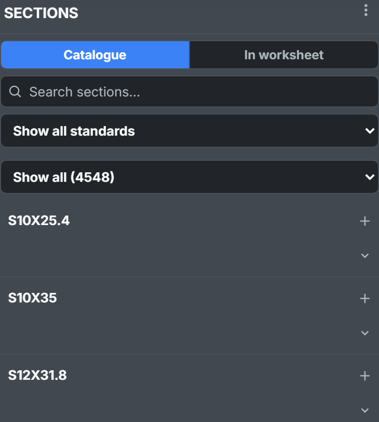
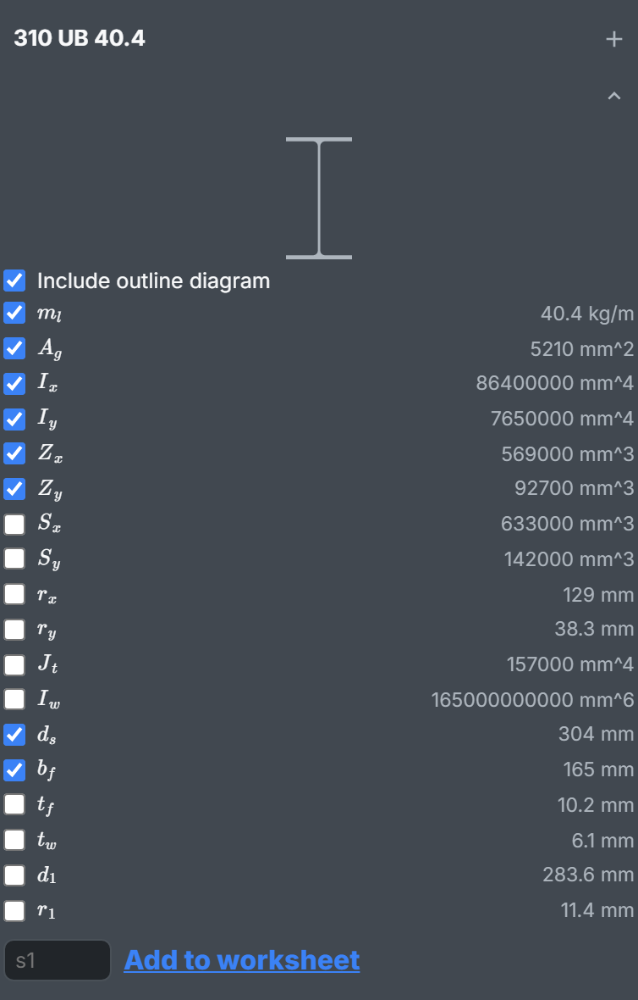
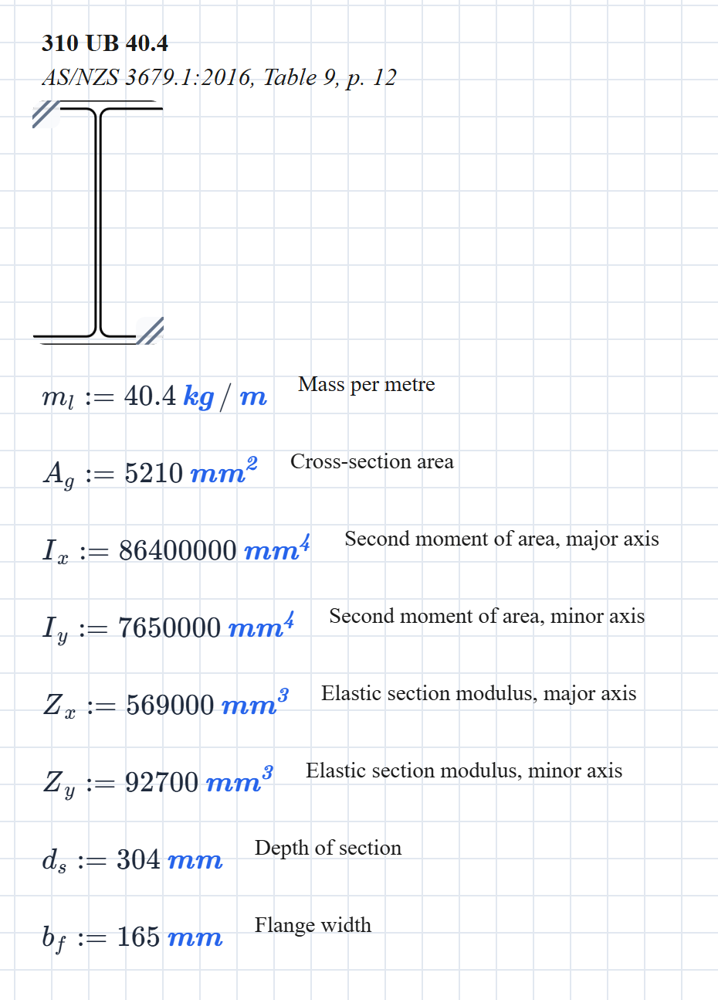
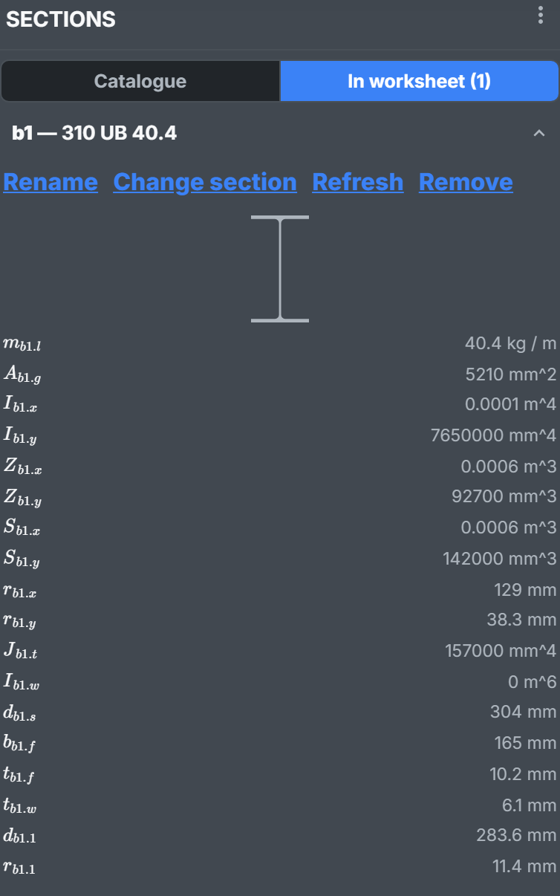
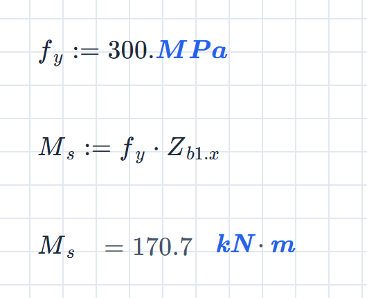
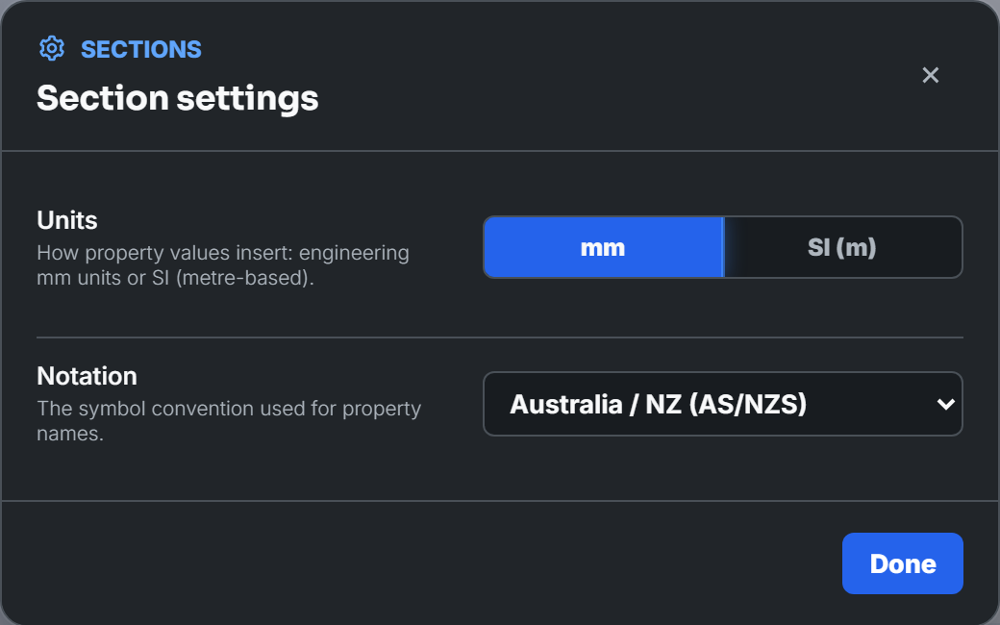

About 4,500 structural steel sections (beams, columns, channels, angles, tees, piles and hollow sections) from AS/NZS, ASTM and BS/EN tables. Pick one and its properties land on the calcsheet, units attached. No more copying $Z_x$ out of a table (or copying it wrong).

Two ways to use one:

- **Insert**: the properties you tick, as ordinary definitions like $A_g := 5210\ \mathrm{mm^2}$. Visible, and it prints.
- **Add to worksheet**: a member name like `b1`, with every property kept in the background ($A_{b1.g}$, $Z_{b1.x}$…). Any number of sections, no name clashes.

Free on every plan; needs an account. The catalogue loads when you first open the panel. If it can't, you get *Could not load the section catalogue.* and a **Retry** button.

## Find a section

Click the section icon in the activity bar. The panel opens on **Catalogue**.

Three filters, applied in order:

- **Standard** (**Show all standards**): AS/NZS sections, ASTM sections, ASTM A1085 HSS or BS/EN sections.
- **Family** (**Show all**): universal beam, equal angle, circular hollow section and so on, narrowed to the chosen standard.
- **Search**: the letters you type, in order, against designation, alternative names and family; best match first. `310ub40` finds **310 UB 40.4**. American shapes answer to their metric names too: `S250X37.8` finds **S10X25.4**.

The list stops at 200: *Showing the first 200 of 4548 sections — refine your search to see the rest.*

## See its properties

The chevron under **+** opens a section: its outline, then every property the data has, in your units and symbols. Hover over a row for its full name.

What's listed depends on the shape: flange and web for an I-section, diameter and wall for a tube. Pre-ticked are mass per metre, area, both second moments, both elastic moduli, and depth and flange width (or diameter and wall thickness).

**Include outline diagram** comes first. Compound sections (back-to-back angles and channels) have no outline, so no box.

## Insert a section

Click the page to place the beacon, then press **+**. With no beacon it goes below everything. **+** on a closed row inserts the pre-ticked set; open the list to choose.

You get:

- **A heading**: the designation, with the standard, table and page in italics. The calc cites its source for you.
- **The outline**, as a diagram block, unless unticked.
- **One definition per ticked property**, its full name alongside.

It arrives selected, so it drags as one. One **Undo** removes it.

Ordinary definitions, ordinary names. Insert a second section and its $A_g$ and $I_x$ replace the first's from there down, silently. So: one inserted section per sheet. For more, name them.

## Name a section

In the open list, type a member name beside **Add to worksheet** (blank takes the suggested `s1`) and click it. The panel switches to **In worksheet**:

Every property is now defined under that name: $A_{b1.g}$, $I_{b1.x}$, $Z_{b1.x}$… Type `Z_b1.x` for $Z_{b1.x}$; autosuggest offers them too.

$$
M_s := f_y \cdot Z_{b1.x} = 300\ \mathrm{MPa} \times 569\,000\ \mathrm{mm^3} = 170.7\ \mathrm{kN \cdot m}
$$

Left alone it reads $170.7\ \mathrm{kJ}$ – a joule is a newton metre, and the units engine can't tell you meant a moment. Put `kN.m` in the unit box.

Worth knowing:

- **Available everywhere.** They're worked out before anything on the page, so a formula can use them above or below where you added them.
- **Saved with the calcsheet.** They work for anyone who opens it, Sections on or off.
- **Not printed.** A printout shows $Z_{b1.x}$ but not its value. Give the checker a block holding just $Z_{b1.x}$.
- **Names** are a letter then letters or digits (`b1`, `col2`, `rafter`), once per calcsheet. No underscores or dots.
- **Symbols are fixed when added.** Changing the notation later doesn't rename existing members.
- **The list rounds; the values don't.** Big values show in metres at the sheet's decimal places: $I_{b1.x}$ as $0.0001\ \mathrm{m^4}$, the warping constant as $0\ \mathrm{m^6}$. Put `mm^4` in a block's unit box and $I_{b1.x}$ reads $86\,400\,000\ \mathrm{mm^4}$.

### Manage named sections

Open a member on **In worksheet**:

- **Rename**: every reference follows (the dialog counts them). One **Undo** reverses it.
- **Change section**: swaps in another section, keeping the name and symbols. Properties the new one lacks go undefined, and the panel says so: *The new section lacks 1 previously referenced property — those references now show as undefined.*
- **Refresh**: fetches the values again, for when the source data is corrected.
- **Remove**: deletes it. The dialog counts the references left undefined.

## Settings

Open **⋮** at the top of the panel, then **Settings…**.

- **Units**: **mm** inserts $A_g := 5210\ \mathrm{mm^2}$, **SI (m)** inserts $A_g := 0.00521\ \mathrm{m^2}$. Same quantity, different literal. Named sections always store mm.
- **Notation**: six regional symbol sets. **Australia / NZ (AS/NZS)** is the default.

Both are saved to your account.

### The notations

The same in every notation:

| Property | Symbol |
| :-- | :-- |
| Mass per metre | $m_l$ |
| Cross-section area | $A_g$ |
| Depth of section | $d_s$ |
| Width of section | $b_s$ |
| Flange width | $b_f$ |
| Flange thickness | $t_f$ |
| Web thickness | $t_w$ |
| Depth between flanges | $d_1$ |
| Root radius | $r_1$ |
| Outside diameter | $d_o$ |
| Wall thickness | $t_s$ |

The rest follow the design standards:

| Property | Europe | US / Canada | Australia / NZ | China | Japan | India |
| :-- | :-- | :-- | :-- | :-- | :-- | :-- |
| Second moment of area, major | $I_y$ | $I_x$ | $I_x$ | $I_x$ | $I_x$ | $I_z$ |
| Second moment of area, minor | $I_z$ | $I_y$ | $I_y$ | $I_y$ | $I_y$ | $I_y$ |
| Elastic modulus, major | $W_{el.y}$ | $S_x$ | $Z_x$ | $W_x$ | $Z_x$ | $Z_{ez}$ |
| Elastic modulus, minor | $W_{el.z}$ | $S_y$ | $Z_y$ | $W_y$ | $Z_y$ | $Z_{ey}$ |
| Plastic modulus, major | $W_{pl.y}$ | $Z_x$ | $S_x$ | $W_{px}$ | $Z_{px}$ | $Z_{pz}$ |
| Plastic modulus, minor | $W_{pl.z}$ | $Z_y$ | $S_y$ | $W_{py}$ | $Z_{py}$ | $Z_{py}$ |
| Radius of gyration, major | $i_y$ | $r_x$ | $r_x$ | $i_x$ | $i_x$ | $r_z$ |
| Radius of gyration, minor | $i_z$ | $r_y$ | $r_y$ | $i_y$ | $i_y$ | $r_y$ |
| Torsion constant | $I_t$ | $J_t$ | $J_t$ | $I_t$ | $J_t$ | $I_t$ |
| Warping constant | $I_w$ | $C_w$ | $I_w$ | $I_w$ | $I_w$ | $I_w$ |

Every symbol has a subscript on purpose. A bare $A$ is the ampere and a bare $m$ the metre; a property named either would take over the unit for the whole sheet.

Stick to one notation per calcsheet. $Z_x$ is elastic in AS/NZS and plastic in US / Canada; $I_y$ is the major axis in Europe and the minor everywhere else. Mix them and a formula quietly picks up the wrong property.
