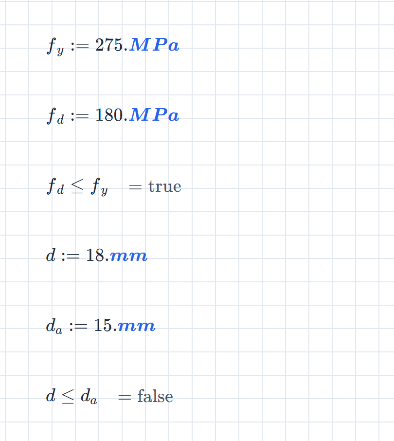
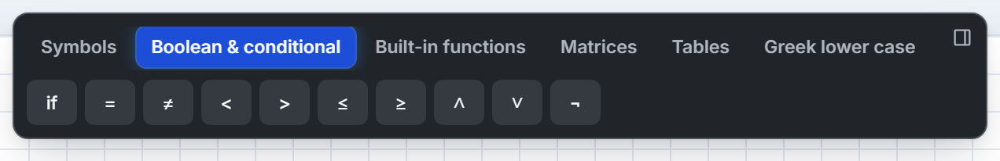
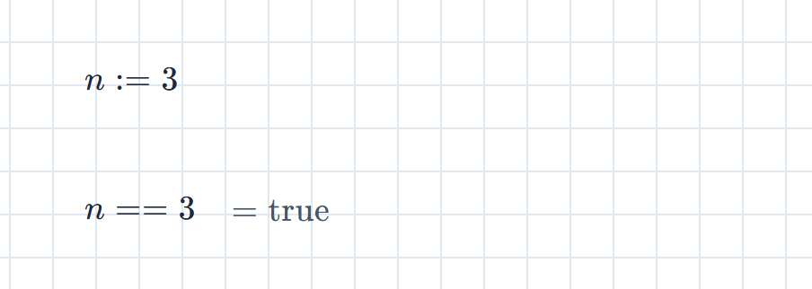
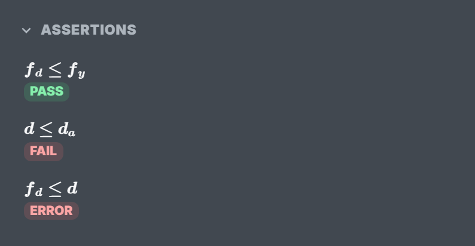
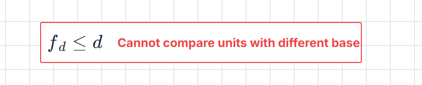

An **assertion** is a maths block that holds one comparison. It doesn't compute a number; it answers *true* or *false*, and answers again every time an input changes. It's how a calcsheet states that the design works (or doesn't) instead of leaving the reader to compare two numbers by eye.

Assertions are available on every plan.

## Write a check

Define the values, then put the comparison in a block of its own:

The third block reads $f_d \le f_y$ and answers `= true`: a design stress of $180\ \mathrm{MPa}$ against a yield strength of $275\ \mathrm{MPa}$. The last reads $d \le d_a$ and answers `= false`: $18\ \mathrm{mm}$ of deflection against an allowable $15\ \mathrm{mm}$.

A check is evaluated like any other block, top to bottom and left to right, so define what it compares above it. Change $f_d$ to $300\ \mathrm{MPa}$ and the first check flips to `= false` on the spot.

## The six operators

| Check | Type | Toolbar button |
| :-- | :-- | :-- |
| $a = b$ | `==` | **=** (Equal to) |
| $a \ne b$ | `!=` | **≠** |
| $a < b$ | `<` | **<** |
| $a > b$ | `>` | **>** |
| $a \le b$ | `<=` | **≤** |
| $a \ge b$ | `>=` | **≥** |

The buttons sit on the **Boolean & conditional** tab of the maths toolbar, which appears whenever the caret is in a maths block.

Typed `<=`, `>=` and `!=` turn into $\le$, $\ge$ and $\ne$ as you type. `==` stays as two equals signs, and so does the **=** button: it inserts `==`.

## Equal means `==`

A single `=` assigns. So does `:=`. Write `n = 3` and you haven't tested whether $n$ is 3, you've redefined it:

This is the commonest way to lose a check: type `=`, get a quiet redefinition where you wanted a verdict. For equality, always `==`.

## Reading the result

On the page, a check shows `= true` or `= false`, like any other result. The page itself stays plain; the colour is in the sidebar.

Open the **Navigate** tab. Every check on the sheet is listed under **Assertions**, in reading order, with its status:

| Status | Means |
| :-- | :-- |
| **PASS** | The comparison is true. |
| **FAIL** | The comparison is false. |
| **ERROR** | It couldn't be evaluated. |

Click an entry to jump to its block. Before you print a sheet or hand it over, scan the list for anything that isn't green.

Whether a check shows its `= true` on the page follows the sheet's **Show expression evaluations by default** setting (see [Calcsheet options](/guides/calcsheet-options/#evaluation-display)). Right-click a block and choose **Hide Evaluation** or **Show Evaluation** to override it for that block. Hiding the answer doesn't remove the check from the list.

### When a check errors

A check that can't be evaluated shows a red message in the block and **ERROR** in the list. It is neither a pass nor a fail.

The usual causes are a name that isn't defined (*Undefined symbol …*) and a comparison between different kinds of quantity, as above. A check you can't evaluate is a check you haven't done.

## What can be compared

**Numbers and units.** Units are converted before comparing, so $1\ \mathrm{m} = 100\ \mathrm{cm}$ is true and $5\ \mathrm{m} > 3\ \mathrm{ft}$ is true. Different kinds of quantity (a stress against a length) can't be compared; that's the error above.

**Full precision, not the displayed figure.** Results are rounded to the sheet's decimal places for display, but a check compares the stored value. With $x := 0.30004$, the result reads $0.3$ at four places, yet $x == 0.3$ is `= false`. Floating-point dust is forgiven: $0.1 + 0.2 == 0.3$ is `= true`.

**Text.** Two pieces of text compare as labels: exactly, and case-sensitively. `"M12" == "M12"` is true; `"M12" == "m12"` is false. Text against a number is simply false, not an error. Press <kbd>"</kbd> to type text in a maths block (see [Keyboard shortcuts](/guides/keyboard-shortcuts/)).

**Vectors and matrices.** Compared element by element. The block shows a true or false for each element, and the check passes only if every one is true. With $v = (1, 2, 3)$, $v > 0$ passes and $v > 2$ fails.

## When a check isn't a check

The rule: a check is a block that is one comparison and nothing else. If it appears under **Assertions**, it's a check. If it doesn't, it isn't, whatever the block says.

- **Chained comparisons.** `0 < x < 10` is read as `0 < x`. Everything after the second operand is dropped, with no error, so with $x = 5$ the block `0 < x < 3` answers `= true`. Write two checks.
- **`and` and `or` conditions.** `(x > 0) ∧ (x < 10)` evaluates and shows `= true`, but it has no PASS or FAIL and isn't listed. Write two checks, or use the condition inside an `if`.
- **Assigning the answer.** `ok := x > 3` defines `ok` as true or false. That's a useful flag, and a definition, not a check.
- **Comparisons inside brackets.** In `if(x > 0, 1, 2)` the comparison belongs to the `if`. It doesn't make the block a check.

## See also

- [Calcsheet options](/guides/calcsheet-options/) for the evaluation-display defaults.
- [Keyboard shortcuts](/guides/keyboard-shortcuts/) for the keys inside maths blocks.
