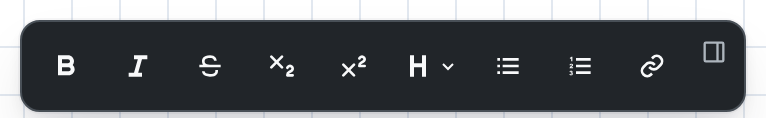
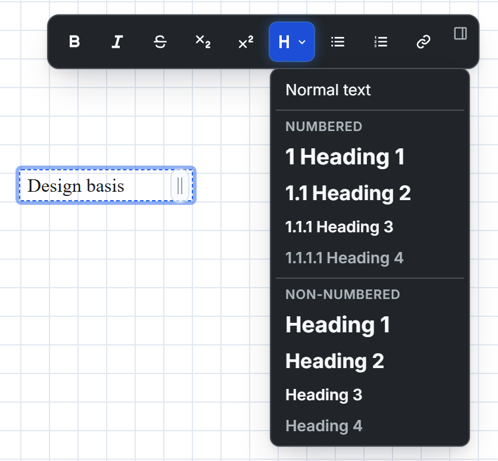
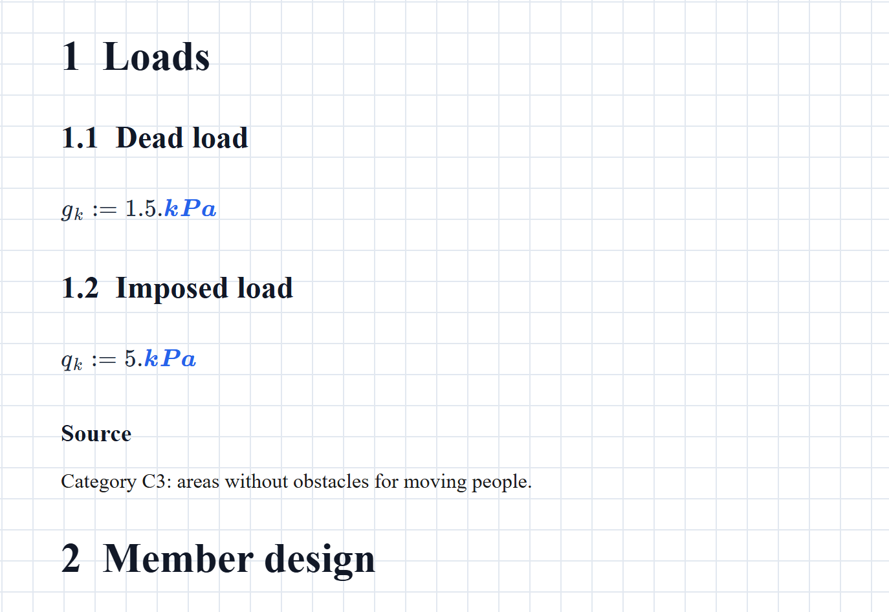
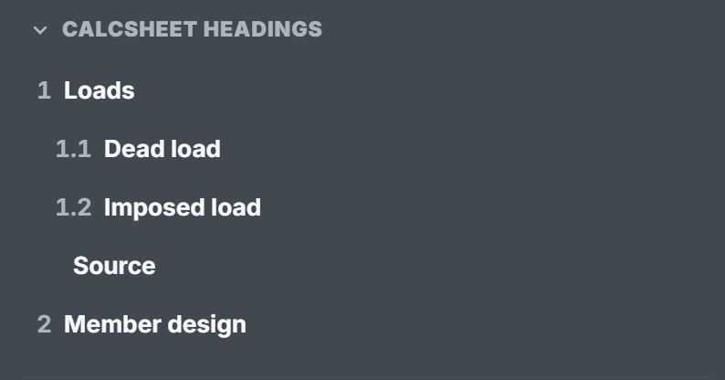
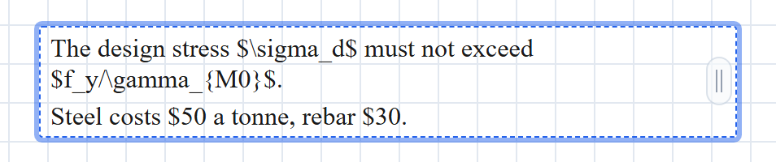
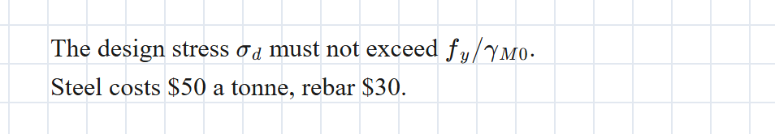
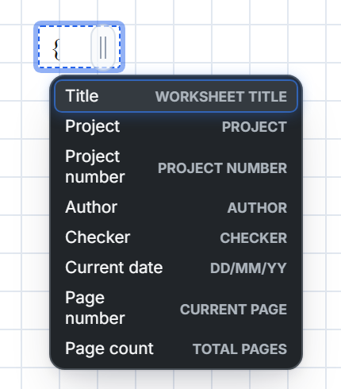
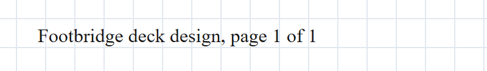
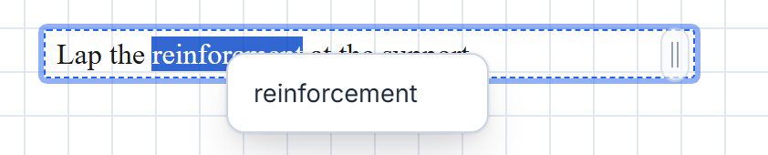

A **text block** holds the words on a calcsheet: the title, the headings, the design basis, the note that says why you picked that load factor. It formats as you type, renders when you click away, and keeps its heading numbers in step with the rest of the sheet. (Underneath, it's Markdown. You never need to know that, but it helps if you do.)

Text blocks are available on every plan.

## Add a text block

Click an empty spot on a page to drop the insertion beacon, then press <kbd>'</kbd> or click **Text** on the beacon's toolbar. The block opens with the caret in it and a faint *Text...* placeholder; just type. A maths block whose first character is <kbd>'</kbd> turns into a text block too, so the reflex works wherever you are.

Press <kbd>Enter</kbd> when you're done. The text is kept and a new maths block opens below it, so a heading, <kbd>Enter</kbd>, and the maths that goes under it is one movement.

A text block you empty deletes itself when you click away.

Pasting into a text block brings in plain text; formatting from the source is dropped. Paste text onto an empty spot on the page instead and the blocks are made for you: prose becomes text blocks, lines of LaTeX become maths blocks.

## Format the text

While the caret is in a text block, the format toolbar floats above the page:

| Button | Does |
| :-- | :-- |
| **Bold**, **Italic**, **Strike Through** | Format the selection, or switch the style on for what you type next. |
| **Subscript**, **Superscript** | For H₂O and m² in plain prose. Press again to come back down to the line. |
| **Heading** | A menu of heading levels; see [Headings](#headings). |
| **Bulleted List**, **Numbered List** | Turn the paragraph into a list. |
| **Link** | Asks for a web address and links the selected text. |

The small icon at the right-hand end, **Dock toolbar right**, parks the toolbar at the side of the window; **Float toolbar top** brings it back.

### Typing shortcuts

You don't have to leave the keyboard:

| Type | Gets |
| :-- | :-- |
| `**` or `__` | Bold on; the same again turns it off. |
| `~~` | Strikethrough on and off. |
| `-` then a space, at the start of a line | A bulleted list. |
| `1.` then a space, at the start of a line | A numbered list. |
| <kbd>Ctrl</kbd> + <kbd>B</kbd>, <kbd>Ctrl</kbd> + <kbd>I</kbd> | Bold, italic. |

<kbd>Ctrl</kbd> + <kbd>U</kbd> underlines while you type, but the underline is gone when you click away. Text blocks don't keep underlining.

Markdown typed out longhand renders when you click away too: `*italic*` for italics, backticks for `code`, and `[text](address)` for a link. The flip side is that a pair of underscores in ordinary text italicises whatever sits between them, so `f_y and g_k` comes out as f*y and g*k. Write symbols as [inline maths](#inline-maths) and the problem goes away.

### Paragraphs and line breaks

<kbd>Ctrl</kbd> + <kbd>Enter</kbd> starts a new paragraph within the block. In a block you've only just added, press it twice: until you first click away from a new block, one press only breaks the line, and the two lines join up again when you leave.

<kbd>Shift</kbd> + <kbd>Enter</kbd> breaks the line while you type, but the break closes up to a space when you click away. That's Markdown's rule: a single line break is a space. If the next line should stand on its own, make it a paragraph.

### Links

Select some text, click **Link** and type the address into the box the browser opens. Links can point at `http`, `https` and `mailto` addresses only.

Hover a link and it says *Ctrl+click to open link*. A plain click puts the caret in the link so you can edit it; <kbd>Ctrl</kbd> + click (<kbd>⌘</kbd> + click on a Mac) opens it in a new tab.

## Headings

The **Heading** button opens a menu of eight headings and a way back:

**Numbered** headings carry a number: 1, 1.1, 1.1.1, 1.1.1.1. **Non-numbered** headings come in the same four sizes with no number. **Normal text** turns a heading back into a paragraph. From the keyboard:

| Keys | Heading |
| :-- | :-- |
| <kbd>Alt</kbd> + <kbd>Shift</kbd> + <kbd>1</kbd> … <kbd>4</kbd> | Numbered, level 1 to 4. |
| <kbd>Alt</kbd> + <kbd>1</kbd> … <kbd>4</kbd> | Non-numbered, level 1 to 4. |

On a Mac, press <kbd>⌥</kbd> for <kbd>Alt</kbd>.

### Numbering runs through the sheet

Heading numbers count across the whole calcsheet, not per block. Each text block picks up where the one before it left off, in reading order: top to bottom, then left to right, page after page. So a heading can live in a block of its own with the maths under it, and the numbers still come out right:

Each heading resets the levels below it: **Member design** is 2, and the next level-2 heading under it would be 2.1. A non-numbered heading, like **Source** above, takes no number and doesn't disturb the count. Move a block and the numbers follow its new place in the reading order. Print or export a PDF and they come along.

One wrinkle: a text block sizes itself to its text without counting the heading number, so a short numbered heading can wrap straight after its number. Double-click the block's resize handle to give it the full width (see [Width](#width)); the headings above have had exactly that done.

### Find headings in the Navigate tab

The **Navigate** tab of the sidebar lists every heading on the sheet under **Calcsheet headings**, indented by level and numbered to match. Click one to jump to it.

### Theme and heading colour

How text blocks look is set once for the whole sheet in **Calcsheet options**: the text theme (Classic, Human or Droid) and the heading colour (black, red or blue, applied to heading levels 1 to 3). See [Text block theme](/guides/calcsheet-options/#text-block-theme).

## Inline maths

Put LaTeX between dollar signs and it's typeset in the line: `$\sigma_d$` gives $\sigma_d$. `\(` … `\)` works as well. While you're editing, the block shows the source so you can fix it:

Click away and it's typeset:

Inline maths is typography, not calculation. It isn't evaluated and doesn't know the sheet's variables; to show a value, use a maths block.

The rules for which dollar sign starts maths are there so that prices stay prices:

- An opening `$` must be followed directly by a non-space character.
- A closing `$` must come directly after a non-space character, and mustn't be followed by a digit.
- `\$` is always a plain dollar sign.
- Nothing inside backticks is maths.

That's why `$50 a tonne, rebar $30` above stays as text: the second dollar sign has a space in front of it, so it can't close anything. If the LaTeX between a pair can't be typeset, the block shows the source in code type instead.

## Calcsheet properties in text

Type `{` and the block offers the calcsheet's properties:

Pick one with the arrow keys and <kbd>Enter</kbd> or <kbd>Tab</kbd>, or type the name and close the brace yourself. While you edit, a token shows as its name in grey italics, such as *{title}*. The rest of the time it shows the value, and changes when the value does. `{title}, page {pageNumber} of {pageCount}` reads:

The values come from the **Properties** page of **Calcsheet options**, which has the [full list of tokens](/guides/calcsheet-options/#using-properties-in-your-text). Three things worth knowing:

- `{title}` is the **Calcsheet title** property, not the filename in the header. Renaming the file in the header leaves it alone.
- `{pageNumber}` is the page the text block sits on.
- `{currentDate}` is today's date, as dd/mm/yy.

## Spell check

Words the browser doesn't recognise get its usual red underline, checked in the browser's own language; the footer shows which, as *Spell check: en-GB* or similar. Right-click a word for up to three corrections, and click one to swap it in:

Those corrections come from Maths Explore's own dictionary, which is US English whatever the footer says. Right-click *colour* and it offers *color*; ignore it. When the dictionary has nothing to suggest, you get the browser's own right-click menu instead. Inline maths, code and property tokens are left out of the corrections.

## Width

A text block sizes itself to its longest line, up to the right-hand edge of the page, and grows downwards as you write. While you're editing, a handle sits on its right edge:

- Drag it to set the width. The text wraps to fit, and the block keeps that width from then on.
- Double-click it to stretch the block to the page's right edge.

## See also

- [Calcsheet options](/guides/calcsheet-options/) for the properties, the text theme and the heading colour.
- [Keyboard shortcuts](/guides/keyboard-shortcuts/) for every key in a text block.
- [Your first calcsheet](/guides/your-first-calcsheet/) for a heading in context.
