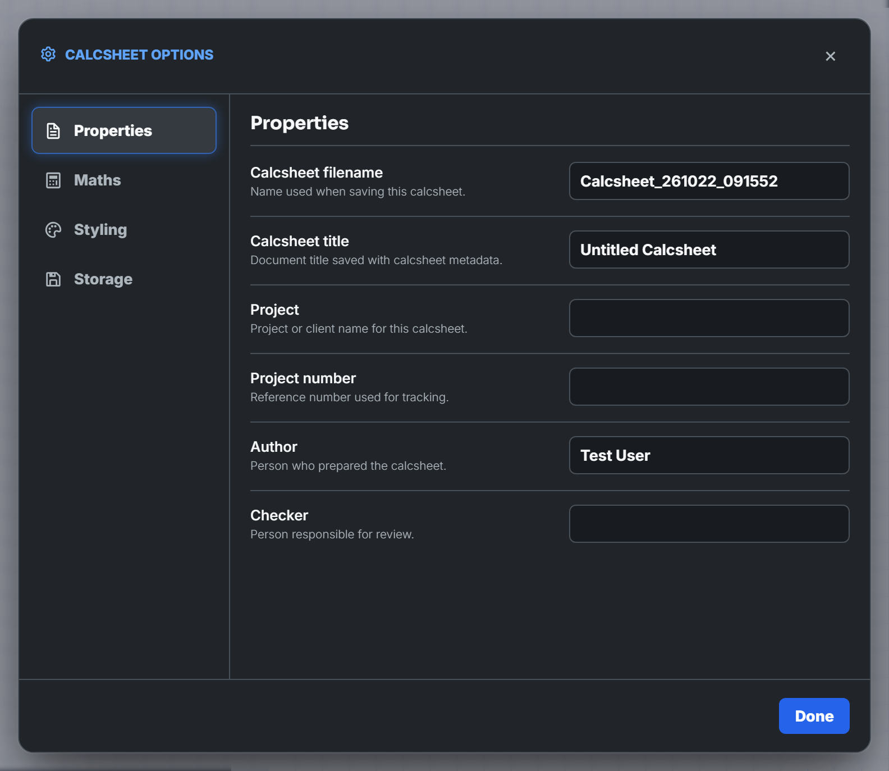
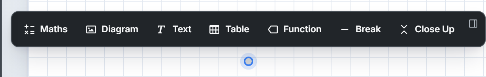
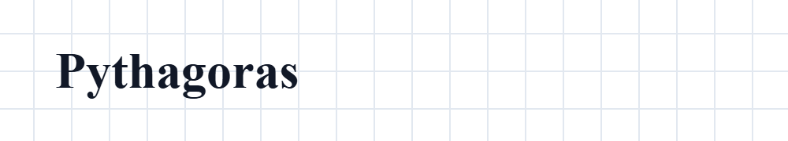
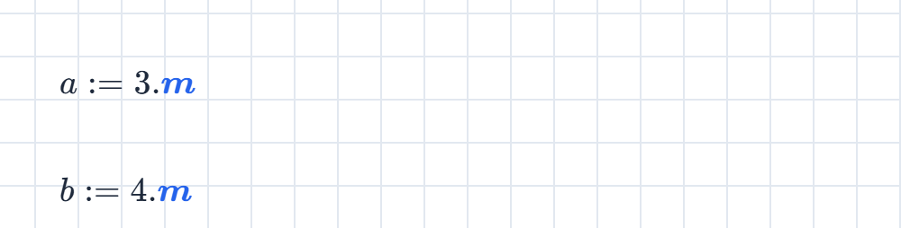
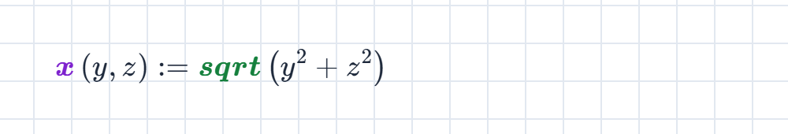
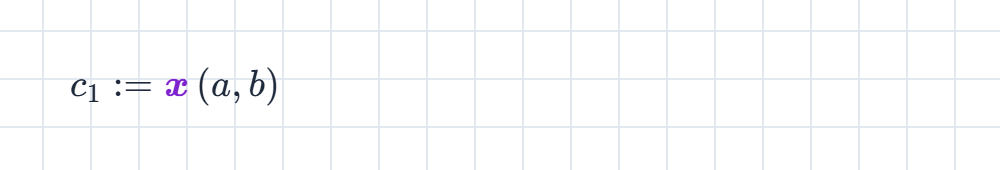
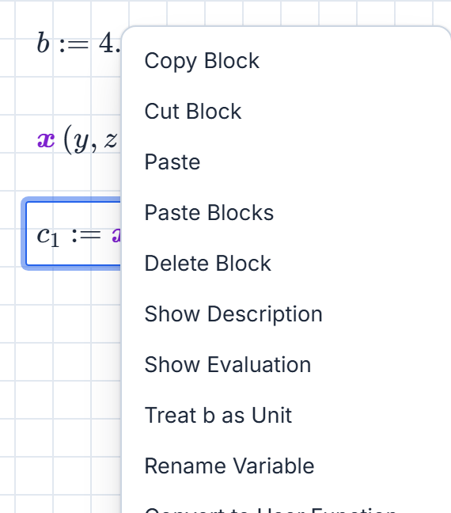
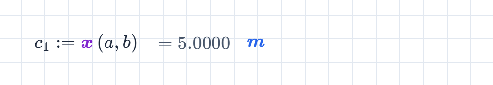
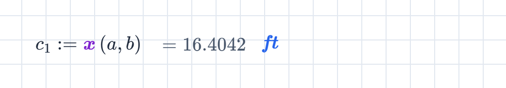
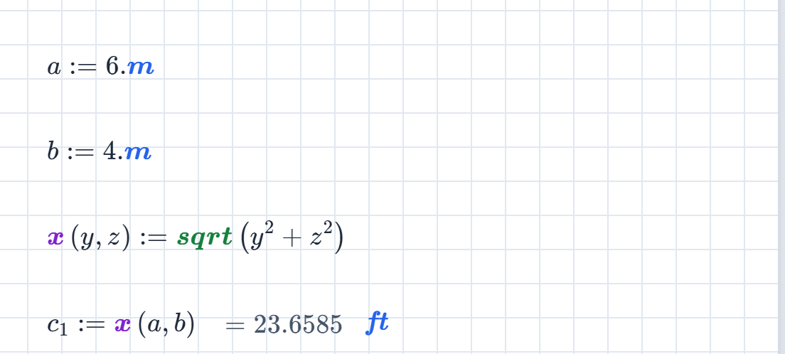

This is the "Hello, world!" of Maths Explore. In ten tiny steps you'll give a sheet a heading, define a function, call it, convert the answer to feet, and watch everything update when an input changes. It takes about three minutes. You'll need to be signed in; [Getting started](/guides/getting-started/) covers that, or you can follow along in the no-account [demo](https://www.mathsexplore.com/try).

## 1. Start a new sheet

On your home page, press **New maths sheet**.


The calcsheet options dialog opens with the fresh sheet. Everything in it can wait: press **Done** to accept the defaults.



## 2. Click anywhere on the page

Click an empty spot near the top of the page. A small marker appears where you clicked, with a toolbar of block types above it.



## 3. Give the sheet a heading

With the marker showing, press <kbd>'</kbd>. That's the shortcut for a text block; you could press **Text** in the toolbar instead. Type `Pythagoras`, then press <kbd>Alt</kbd> + <kbd>1</kbd> to format the line as a heading.



<kbd>Alt</kbd> + <kbd>1</kbd> to <kbd>Alt</kbd> + <kbd>4</kbd> set the four heading levels. Add <kbd>Shift</kbd> and the headings number themselves through the sheet.

## 4. Define the two sides

Click below the heading and type `a:3.m`, just like that. The `:` key types the assignment symbol `:=`, and `.m` attaches the unit metres, shown in blue. Then click a little lower and type `b:4.m` the same way.



## 5. Define a function

Click below again and type:

```
x(y,z):sqrt(y^2+z^2)
```

That defines $x$ as **your own function**: give it any two lengths and it returns the hypotenuse. Its name turns purple, and `sqrt` is green because it's a built-in. The parameters $y$ and $z$ live only inside the function, so they don't clash with anything on the sheet.



## 6. Call it, with a proper engineering name

Click below once more and type `c_1:x(a,b)`. The underscore drops into a **subscript**, and when you press <kbd>:</kbd> the caret hops back out on its own, so the name comes out as $c_1$.



Subscripted names are ordinary variables, which is how engineering symbols like $N_{b,Rd}$ stay writable. The block shows no result yet, and that's the next step.

## 7. Show the result

A definition keeps its result to itself by default. Right-click the block and choose **Show Evaluation**.



The result appears inline, units and all:



## 8. Show it in feet

Click the small $\mathrm{m}$ at the end of the result. That's the block's **result unit** box. Replace it with `ft` and press <kbd>Enter</kbd>:



Only the display converts; the maths underneath still works in exact quantities. Clear the box to go back to the natural unit.

## 9. Change an input

This is the point of a calcsheet. Click into the first line, change the $3$ to a $6$, and click away:



The result follows immediately, still in feet. Every block on a sheet works this way. Change any input and everything that depends on it recalculates, in reading order down the page.

## 10. Name it

Click the name at the top of the workspace and type something memorable.


There is no save button to remember: moments after each change, **Autosaved** appears at the right of the header, and the sheet is kept in this browser. You'll find it on your home page under **Autosaved** next time. When you want a file on disk, use **Save** in the worksheet menu (the ☰ button) for a portable `.mez` file.

## Where next

- Make the result pretty: right-click a block for decimal places, or explore the toolbar's symbols, fractions and Greek letters.
- [Keyboard shortcuts](/guides/keyboard-shortcuts/) to write sheets without the mouse, including <kbd>Enter</kbd> for a new maths block below the current one.
- [Tables](/guides/tables/) and [Matrices](/guides/matrices/) when one value at a time stops being enough.
- The worked [samples](https://www.mathsexplore.com/samples) show full calcsheets you can open and pull apart.
